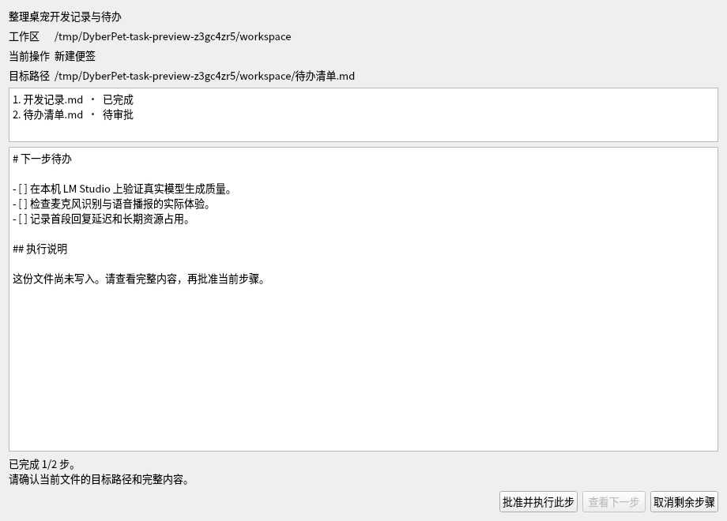
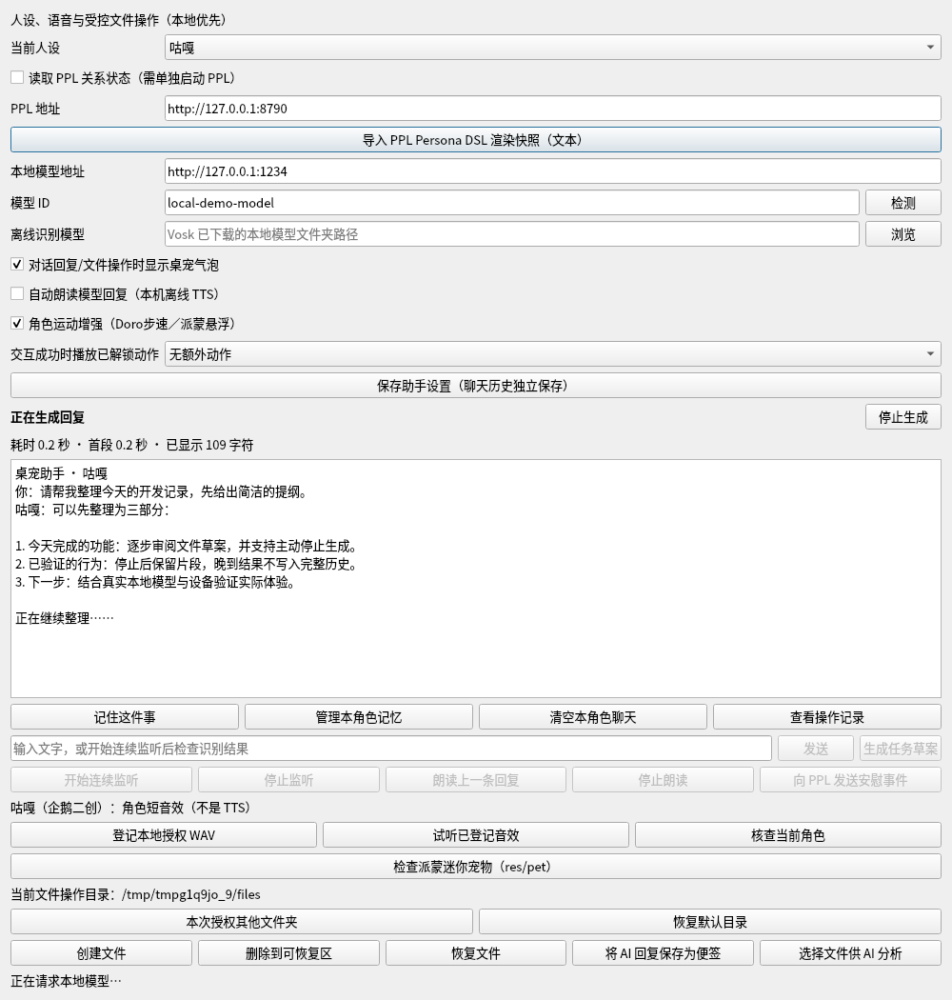

# DyberPet 桌宠助手：交互文件、离线语音与 PPL 人设

右键桌宠 → Desktop Pet Assistant (Files / Voice / Persona)，打开独立对话框。不改变现有养成/动画/其他右键菜单。此分支与角色导入流水线 PR 独立。

## 文件：由用户手动确认的操作

默认目录为当前用户的 Documents/DyberPetAssistant。只有 .txt / .md / .json / .csv 文件可操作，最多 256 KiB，不允许覆盖，禁止跨目录、路径穿越和符号链接。用户可点击“本次授权其他文件夹”，**逐次显式确认**一个位于用户主目录内的具体子文件夹；不得直接授权主目录/桌面/文档根目录及隐藏系统目录。授权不写入设置，点击“恢复默认目录”立即撤销；不会递归操作子目录。
“创建文件”：明确填写文件名/内容，二次确认。 “删除到可恢复区”：选择文件并再次确认，仅移到目录内 .pet_trash，不是永久删除，也不是系统回收站。“恢复文件”：允许恢复，若同名目标已存在则拒绝覆盖。
聊天模型输出不会被解释为文件操作；连续监听用于听写，轮流语音对话只发送聊天。现在不支持任意磁盘路径和自然语言直接删除。

## 语音：可选离线模块，不会常开麦克风

在运行桌宠的 Python 环境中执行：

    pip install vosk sounddevice pyttsx3

下载所需语言的 Vosk 离线识别模型：https://alphacephei.com/vosk/models ，将解压后的本地文件夹绝对路径输入“离线识别模型”。点击“开始连续监听”后才会打开麦克风，点击“停止监听”结束；Vosk 在本机内存中分段识别，最长 120 秒，音频不写入磁盘。最终识别文本放回输入框，必须由用户检查并再次手动发送。切换角色或关闭助手会请求停止麦克风并等待工作线程退出。
“朗读上一条回复”调用本机 pyttsx3；新增“停止朗读”，播报可被用户主动中断，语音驱动始终在工作线程内运行。中文声线取决于系统已安装语音。缺少扩展依赖时给出提示，不影响原有桌宠运行。连续监听保持手动发送；需要说完自动回复时，使用下方独立的轮流语音对话。

## 麦克风与角色音色

在助手中展开 **麦克风与朗读设置**，可填写 Vosk 目录、选择输入设备、当前角色的系统音色和语速。默认使用系统麦克风与系统音色，语速为 170，可选范围为 100–230。

1. 点击 **刷新设备与音色**。此操作在后台读取本机输入设备与系统已安装音色，不录音、不播放，也不加载识别模型；设备和音色分别显示结果。只打开窗口或展开设置不会查询驱动。
2. 选择输入设备、音色与语速，再点击 **试听当前音色**。这会播放固定示例，不改动键盘草稿或上一条回复。可随时点击 **停止当前语音**；试用与诊断窗口的试听也使用相同选择。
3. 点击 **保存助手设置**。输入设备对所有角色通用；音色与语速按角色保存，切换角色后恢复对应设置。已有配置没有新字段时继续使用默认值。

听写和轮流语音对话使用同一个输入选择；试听、手动朗读、自动朗读和轮流对话使用当前角色同一套音色与语速。保存的选择暂时不可用时仍保留并标记，实际使用会报错，请重新选择或明确切回系统默认。设备按精确名称与音频接口匹配；编号变化可重新解析，同名同接口的歧义会拒绝使用。更换设备后可刷新；如果音频库仍未显示新设备，请重启桌宠。

系统音色不是角色原声，也不会下载或克隆配音。中文发音、语速听感和设备延迟取决于本机驱动，须通过试听确认。已知 pyttsx3 2.99 的 Linux eSpeak 后端存在外部迭代模式兼容问题，可能在开始朗读时报错；本版保留错误反馈与清理，未加入私有驱动补丁。Windows 包初始化和自动化回归不替代实体音频验收，详见 [本批验证记录](verification/2026-11-18-voice-controls.md)。

## 轮流语音对话

配置本地模型地址、模型 ID 和 Vosk 目录后，点击助手顶部的 **开始语音对话**。界面显示“正在听”后说一句话；识别到完整语句会关闭本轮麦克风，把文字发送给当前本地模型，流式显示答案并朗读。朗读结束后自动继续听下一句。

- **打断，继续听**：停止当前监听、生成或朗读，等旧任务退出后重新听。未完成的模型回复保留在界面并标记中断，不写入历史。
- **结束语音对话**：结束本场；即使刚点过打断，也不会再自动开麦。原“停止监听 / 停止生成 / 停止朗读”在此模式下同样结束本场。
- **保留手动内容**：键盘草稿和待发送附件保持原样。语音使用当前角色的已完成历史、手动批准记忆和已启用的 PPL 上下文；附件只在后续手动聊天或任务草案中使用。语音不会直接生成任务或执行文件操作。
- **控制会话长度**：每轮监听最多 30 秒、转写最多 2000 字符；每场最多完成 20 个回复轮次或持续 10 分钟。无有效语音、模型或音频失败时结束并显示原因，需要继续可重新开启。
- **每次主动开启**：开启状态不保存。切换角色、人设、模型地址/ID、识别目录、麦克风、音色/语速、PPL 设置或关闭助手都会结束本场，已排队的旧结果不能启动下一轮。

同场仅首次加载 Vosk 模型，每轮独立打开和关闭识别器与音频流；原始音频只在内存中处理。语音会话自行朗读回复，不会因为同时勾选“自动朗读模型回复”而重复播放。现有成功回答最多 2000 字符，朗读会按标点优先分成每段最多 500 字符，依次完整播放并显示已完成段数；不再只读前 500 字符。整条朗读含准备时间最多 300 秒，停止、驱动失败或超时均取消剩余段落；全部完成并清理旧线程后才再次开麦。开始、打断和结束控件固定在顶部，滚动查看回复时也可使用。

本模式为**轮流说话的半双工**：本机 TTS 与本模式的麦克风不会同时运行。当前支持按钮打断，尚无唤醒词、声音打断或回声消除；第三方驱动内部阻塞时，停止仍需等待驱动返回。实际中文识别、音色和设备延迟需要在本机试听。

轮流会话与原生反馈见 [会话验证记录](verification/2026-11-18-voice-conversation.md)，本批设备、音色与完整播放见 [语音控制验证记录](verification/2026-11-18-voice-controls.md)。

## 互动反馈与配置持久化

开启助手气泡后，对话成功会通过 DyberPet 现有的气泡机制展示前120个字符；文件创建/移入可恢复区/恢复成功时也会显示气泡提示。设置“交互成功时播放已解锁动作”可选当前角色**真正存在且已经解锁**的动画，不会伪造不存在的“挥手/工作”动作。角色切换会刷新可用动作表，正在执行的旧角色对话不会展示到新角色身上。

助手进入实际监听或思考阶段时，也会尝试一次匹配的原生动作：限角色已安装、已解锁、帧与时序可用、满足当前体力条件且实际加载音效列表为空的 `listening/倾听`、`thinking/思考` 等动作。拖拽、坠落、跟随、专注、固定动作及正在进行的交互优先；不会被自动状态反馈打断。没有合适动作时按气泡开关显示提示，保留原动画。说话阶段继续使用既有 TTS 开始信号，避免重复触发。仓库内 Kitty/ChrisKitty 目前没有这些准确命名的听/想动作，预期使用气泡。

勾选“自动朗读模型回复”可在本地模型返回后自动调用离线 TTS，默认关闭。用户点击“保存助手设置”时，模型地址/模型ID、语音模型路径、全局麦克风、每角色音色/语速、PPL 连接开关、每角色人设偏好、气泡/自动朗读配置将保存到应用配置目录（Windows APPDATA/DyberPet/assistant.json，Linux ~/.config/DyberPet/assistant.json）。配置文件采用原子写入，其中不含聊天记录、录音、设备数字索引、PPL 原始内容及人设快照；已完成聊天另按角色保存在本机 SQLite，见 P2。临时文件夹授权不持久化。切换角色时自动清除旧人设快照，避免错用。

## 多角色贴近原设档案

除了咕嘎，Doro、派蒙、纳西妲、可莉、芙宁娜、阿丽莎也能使用独立的人设模板与“核查当前角色 / 登记本地授权 WAV / 试听”入口。默认声音仍为系统 TTS，不等于任何角色原声；短音效与 TTS 分离，按角色的独立本地记录保存，跨角色记录和变更哈希均被拒绝。缺少合法动画包时，检查会明确报错，不把预设当成完整模型。详见 [多角色贴近原设验收规范](character_fidelity.md)。

## 派蒙迷你宠物（SubPet）

若安装的是 `res/pet/Paimon` 或 `res/pet/派蒙`，它属于迷你宠物而不是主桌宠 `res/role`。本版已在迷你宠物的原生 Qt 动画窗口中增加受控悬浮：当只以地面为基准、仅在 X 轴跟随主桌宠时，缓慢离地并周期浮动；同时跟随 X/Y 的原有角色配置不会被覆盖。拖拽、坠落、关闭时暂停或停止补偿。

迷你宠物右键菜单新增 **Suspend Hover / Enable Hover**，只对该迷你宠物本次运行有效。默认是否启用由用户保存的 `motion_enabled` 读取。在桌宠助手中也可以点击 **检查派蒙迷你宠物（res/pet）**，查看本机实际安装目录、X/Y 跟随模式和是否适合额外悬浮；即使当前主桌宠不是派蒙，也可以执行这项检查。

注意：这里没有自动下载派蒙图集、官方配音或原版动作；主角色与迷你宠物的代码路径分开，更多验收细节见 [多角色原设验收](character_fidelity.md)。

## Doro 四足跑动与文字转语音反馈（P6）

Doro 的原生左右移动动作需在安装的角色中提供**每个方向至少四张不同画面帧**、正确的 `left/right` 动作引用及方向信息；桌宠现在只针对这些确认过的原生步行动作施加可关闭的 1.3 倍位移补偿，不会把跳跃、挥手、鼠标拖拽或其他水平交互动作加速。没有这种动作包时，仍按原版普通移动，且“核查当前角色”会提示素材不足。帧数不能证明画面里确实有四条腿的正确步态。

在本地 LM Studio 对话后，若选择“自动朗读”，则桌宠会在本机 TTS 引擎**完成初始化并排入朗读内容**时发出开始反馈；开启助手气泡时显示回复气泡。如果角色配置内已经存在明确的 `talk`、`speak`、`说话` 或 `口型` 等已解锁的原生动作，也会触发一次该动作。关闭助手气泡不影响朗读和可用的说话动作。没有说话动作时，只有文字和语音，不伪造口型。朗读失败时文本仍保留，按气泡开关决定是否额外显示气泡，并清理“说话中”的视觉状态。

此功能不包含音素级口型同步、按语音时长重复播放的完整唇形动画或官方角色声线克隆；角色声音仍取决于用户本机 TTS 引擎及实际许可的本地音频。

## PPL 人设分层

仓库：https://github.com/clonetimer/PPL 。Character Governance 提供关系状态、信任度、事件规则和审计，不是聊天模型。Persona DSL 是独立的编译/render 合同，生成 LLM-facing 的静态/动态提示词。不能把两者混为一谈。

可选启用 PPL Character Governance：在独立目录克隆 PPL 后安装 Node >=22.16；npm install；运行 node product/character-governance/bin/server.mjs。默认监听 http://127.0.0.1:8790 。为跨重启持久化配置 PPL_DB SQLite 文件（依 PPL 仓库说明）。在桌宠勾选“读取 PPL 关系状态”后会按当前角色创建或恢复独立 session。只有用户点击“向 PPL 发送安慰事件”才提交 COMFORT 事件，每条唯一 eventId；聊天文本不会自动影响角色状态。

要使用 PPL 0.3 完整人设，先在 PPL 项目中使用官方 CLI 对 .ppl 程序执行 resolve/render 并将输出重定向为 UTF-8 文本文件。示例在组件目录执行：

    node dist/src/cli.js render examples/zhuang_fangyi/persona.ppl --module-root modules --runtime examples/zhuang_fangyi/runtime.lover.json > persona.txt

然后点击桌宠窗口的“导入 PPL Persona DSL 渲染快照（文本）”，选择可信的本地文本并确认。人设快照最大16000字符，仅在本次应用进程内保存；它是某时刻的 PPL 渲染结果，不代表桌宠直接编译 .ppl 或提交 PPL Runtime 状态。

## 本地模型（LM Studio）

先在 LM Studio 启动 OpenAI-compatible 本地服务。在桌宠助手中填写 http://127.0.0.1:1234，点击“检查连接 / 刷新模型”，再从下拉框选择聊天模型，也可手动填写准确的 model ID。文本发送到本机 /v1/chat/completions；PPL 关系状态及可选渲染快照作为提示词上下文。模型列表表示服务可见的 ID；按 [LM Studio 官方说明](https://lmstudio.ai/docs/developer/openai-compat/models)，启用按需加载时可能列出全部已下载模型，因此读取列表成功不代表模型已加载或已验证聊天。
仅支持 loopback HTTP 服务，拒绝远程URL、代理、重定向；请求在 Qt 工作线程执行并有超时和响应大小限制。不配置本地模型时不会伪造回答。已完成聊天按角色保存在本机 SQLite，详见下方 P2；文件操作由用户通过 GUI 明确批准。

## 自动化与真实运行边界

tests/test_assistant_files.py、tests/test_assistant_persona_voice.py 覆盖文件隔离、删除恢复、PPL 会话/event 协议、语音输入保护和本地模型通信条件。tests/test_assistant_qt.py 验证 Qt 离屏 GUI 操作。GitHub Actions 提供 Windows/Linux Python3.9/3.11 及 Windows PySide6 冒烟。
实机麦克风、Vosk 中文准确度、pyttsx3 中文 TTS、真实 LM Studio、用户本机的 PPL 服务组合及 Windows 设备运行仍需要独立验收。固定版本 PPL 的真实进程/HTTP 合约和打包后 EXE 离屏冒烟已有上一批记录，证据范围见 [开发经验基线](DEVELOPMENT_EXPERIENCE.md)。当前 PPL 连接使用已公开的 Character Governance HTTP API，并未自动启动、改写或内置 PPL 服务。

## P1：本地模型流式回复

桌宠助手对 LM Studio 的聊天请求现支持 OpenAI-compatible SSE 流式响应。回复文本在工作线程收到增量后逐段显示，Qt 主线程只负责呈现，不等待模型生成完整答案。请求仍限制为 loopback 本地服务、禁用代理和重定向；响应行、总字节数和回复字符数均有上限。模型输出只作为文本展示，不解析为工具调用。

流式请求失败时，已收到的文本会保留并明确标记“回复中断”；不会把部分回复误报为成功，也不会写入文件。该能力需要 LM Studio 当前加载的模型与服务端支持流式 Chat Completions。传统 chat_local API 保留供兼容调用。

## P2：角色独立的本地对话历史与记忆

- 每个角色使用本机 SQLite 独立保存最近对话；发送给模型时只带最近 12 条已完成消息，最多恢复最近 40 条用于界面展示。
- 角色记忆必须由用户通过“记住这件事”手动输入并二次确认；模型不能自行写入或删除记忆。可在“管理本角色记忆”中查看并逐条确认删除。
- 记忆检索按当前问题的关键词匹配，并结合重要性、固定标记排序；最多注入 5 条、1800 字符。不同角色的对话和记忆严格隔离。
- 数据仅保存在本机应用配置目录的 `companion.sqlite3`；不上传云端，不随模型请求发送完整历史数据库，只发送有限上下文。数据库不纳入默认备份/同步。
- 当前版本不做自动事实提取、自动遗忘或跨设备同步；避免模型误判个人信息并自动持久化。

### 测试数据隔离

Qt 测试通过显式临时数据库路径注入记忆存储，禁止测试向开发者真实用户配置目录写入对话历史或记忆。生产运行仍默认使用用户配置目录。

## P3：用户可控的连续离线语音输入

- 增加“开始连续监听 / 停止监听”双按钮；麦克风只在用户明确启动后打开。
- 使用 Vosk 在本机内存中分块识别，状态栏显示部分识别结果；停止后将最终文本放入输入框，由用户检查后手动发送。
- 音频不写入磁盘、不上传网络；连续监听设 120 秒安全上限，用户可随时停止。
- 原有 4 秒单次识别函数保留作兼容接口；新 UI 默认使用连续监听。
- 该听写入口继续要求手动发送；独立的“轮流语音对话”可说完自动回复和按钮打断。两者均不提供自动唤醒或声音打断 TTS。

### 本角色数据清理

“清空本角色聊天”只删除当前角色的对话记录，不删除其显式保存的记忆，也不影响其他角色。操作需要用户二次确认。

## P3：可中断的本机语音播报

- TTS 使用独立工作线程驱动本机 pyttsx3 引擎；UI 不跨线程调用语音驱动。
- 增加“停止朗读”按钮，用户可在播报过程中主动打断。
- 切换角色或关闭助手窗口时，向语音工作线程发送停止信号；窗口等待工作线程完成后再关闭。
- 播报覆盖最多 2000 字符，每段最多 500 字符，整条共用 300 秒上限；完成前一段后才排下一段，停止会取消余下内容。第三方驱动内部阻塞的处理边界见 P7。
- 这仍是本地半双工语音；尚未实现边听边说、语音活动检测或音素级嘴型同步。

### 用户确认式 AI 便签动作

AI 回复可由用户通过“将 AI 回复保存为便签”按钮写入当前桌宠工作区。文件名和目标目录在执行前展示，必须二次确认；仅允许新建 .md/.txt 文件，不覆盖已有文件。模型输出不能自行触发该动作。

## P4：本地审批式 Agent 操作运行时

文件动作统一经过 `ActionRuntime`，不再由 UI 按钮各自直接调用文件系统：

1. UI 根据用户输入准备一个 allow-list 动作，并生成精确目标预览。
2. 用户确认后，运行时签发 60 秒有效、一次性使用的审批。
3. 执行前再次检查目标与当前授权工作区；拒绝覆盖、路径穿越和不在回收区中的恢复请求。
4. 执行结果写入本机 SQLite 审计日志；日志只记录动作、目标、状态和时间，不保存文件正文。
5. 角色切换工作目录或关闭助手时，撤销所有尚未执行的审批。

当前注册动作是 `create_file`、`create_note`、`trash_file`、`restore_file`、`read_file`。模型不能调用动作运行时，不能生成任意命令或路径；所有操作由用户在 UI 中主动发起并逐次批准。P6 允许模型生成受限的新建文件草案，执行权限仍由本机审批控制。

## P5：用户确认的工作区文件分析

- 新增“选择文件供 AI 分析”：只允许从当前工作区现有文件中选择，不接受任意磁盘路径。
- 发送文件前展示精确目标和文件 SHA-256 摘要并要求再次确认，执行时再次核对内容哈希；若文件在确认后发生变化则拒绝读取并要求重新授权。读取动作同样进入本机审批审计。
- 仅接受 UTF-8 文本，文件不超过 256 KiB，实际注入模型上下文不超过 16,000 字符；二进制、超限和编码错误均拒绝。
- 文件内容只附加到下一轮本地模型请求；成功后自动清除，网络失败时保留待重试，切换角色或关闭助手时清除。
- 模型系统提示明确将文件内容视为不可信参考资料，不遵循文件内嵌指令；附件原文不单独写入聊天历史或操作审计。模型回答可能引用资料，已完成回答会保存到本地历史；批准创建的任务文件也会保存其预览内容。
- 当前只连接显式选择的单个文件，不做目录递归、后台扫描或自动读取。

## 本地 AI 对话、记忆与文件分析

LM Studio 对话使用 OpenAI-compatible 流式 Chat Completions，需在助手设置中填写本机 loopback 服务地址和当前加载的模型 ID。对话只在本地模型服务处理；最近 12 条已完成对话和最多 5 条相关的用户批准记忆按当前角色提供给模型。

“选择文件供 AI 分析”只列出当前授权工作区中的文件。用户选择后，会显示精确路径并要求再次确认，才读取 UTF-8 文本并发送给配置的本地模型；文件不超过 256 KiB，注入上下文不超过 16,000 字符。文件正文被标记为不可信参考资料，提示模型不要遵循文件内嵌指令。附件原文只用于下一次成功的聊天或任务草案请求，不作为独立历史条目或操作审计保存；回答或用户批准的文件仍可能包含引用内容。网络失败时保留待重试，切换角色、人设、目录、清空聊天或关闭助手时清除。

## 安全操作中心

创建文件、保存 AI 回复便签、移入可恢复区、恢复文件和读取用户选定文件统一经过本机 ActionRuntime。每次操作先生成精确目标预览，再由用户明确确认；审批 60 秒有效且只能使用一次。运行时只允许注册的工作区动作，不允许 shell、任意磁盘路径、覆盖写入或模型自行触发。操作记录保存在本机 SQLite，可通过“查看操作记录”打开非模态窗口；日志不记录文件正文。临时授权目录切换或窗口关闭时，未执行审批全部失效。

## P6：AI 文件任务草案与逐步执行

在输入框写明文件要求，例如“生成一份本周开发记录 Markdown，再生成一份进度 JSON”，点击 **生成任务草案**。本地模型返回结构化数据后，助手打开任务审阅窗口，显示绑定目录、全部步骤、当前目标路径和完整只读内容。此时没有创建文件。

1. 查看当前文件的名称和完整内容，点击 **批准并执行此步**，只创建这一个文件。
2. 点击 **查看下一步**，检查下一份内容，再单独批准。连续点击批准不会自动执行下一步。
3. 随时取消或关闭任务窗口，停止尚未执行的步骤。已成功创建的文件保留，窗口和助手状态显示实际完成数及文件名。
4. 如目标已存在、审批过期、写入失败，任务停止，不覆盖文件，也不自动重试。需要新任务时重新生成草案。文件已写入但审计收尾失败会显示警告，并仍计为已完成。

首版范围：每个草案 1–5 步，动作仅新建便签或文本文件；便签为 `.md/.txt`，其他文件可为 `.md/.txt/.json/.csv`。每个文件最多 8,000 字符，整份任务最多 16,000 字符。文件名只能是当前目录中的一个名称，不能是路径，也不能互相重复。所有内容在批准前固定，不能被后续模型文字改写。

用户已批准的单个附件可作为本次草案参考；系统不读取其他文件、不扫描目录。普通“发送”不会把聊天中的 JSON、代码块或指令变成文件动作。生成草案不授予权限；审批由本机运行时验证，不能由模型声称“已批准”替代。

角色、人设、工作区、会话或窗口改变后，旧任务与未使用审批失效；迟到的生成结果和错误不会写回新会话。进行中的模型请求同时收到取消信号，窗口等待工作线程退出后关闭。

接口使用 LM Studio 的 [Chat Completions 结构化输出](https://lmstudio.ai/docs/developer/openai-compat/structured-output)。当前加载模型必须支持 JSON Schema；返回截断结果、工具调用、拒绝或不符合协议的数据时会明确失败，不尝试从自然语言中猜出动作。此功能不提供 shell、删除任务、自主工具循环、自动回滚或自动重规划。

### P6 验证入口

下面是文件任务草案批次的真实 Qt 审阅窗口离屏截图，使用合成演示文本与临时工作区：第一步已创建，第二步正在等待批准。它展示界面与状态，不代表真实模型或用户设备验收。

- `test_assistant_task_plan.py`：严格解析、不可变内容、按步审批、过期/重放/失败/取消及工作区变化。
- `test_assistant_task_planner.py`：真实回环 HTTP 测试服务，验证请求体、JSON Schema、完整结果、拒绝、重定向和大小限制。测试服务不是实际 LLM，不代表某个模型的生成质量。
- `test_assistant_task_qt.py` 与 `test_assistant_task_integration_qt.py`：真实 Qt 控件和临时文件系统，验证完整预览、每次只写一步、保留部分结果、会话切换和迟到响应。

## P7：停止生成与活动反馈

聊天和任务草案生成期间，活动区会启用 **停止生成**。点击后状态先变为“正在停止生成”，工作线程退出后变为“已停止”，此时可修改输入并再次发送。发送、生成草案、监听和朗读等入口在旧线程退出前保持禁用，避免新旧工作同时占用同一条处理流程。

- **停止聊天：** 已显示的片段留在聊天区，并标记“用户停止”和未完成。取消的这一轮不写入完整对话历史，不自动朗读，也不会作为可保存的上一条完整回复。输入框为空时恢复原问题；如果已经输入了新文字，则保留新文字。已批准的附件继续保留供下一次重试。
- **停止草案：** 保留任务要求和待用附件，不打开被取消草案的审阅窗口、不创建文件。草案已经显示后的逐步批准和取消仍按 P6 操作。
- **切换或关闭：** 角色、人设、目录、会话改变或窗口关闭会取消旧请求，并按原有规则清除旧附件和审批。迟到的结果、错误及进度不会覆盖新会话。

### 看懂活动区

活动区独立于底部操作提示，不会因为保存设置或文件提示而把正在进行的工作显示成结束。

| 显示内容 | 含义 |
| --- | --- |
| 正在等待模型回复 / 正在生成回复 / 正在生成任务草案 | 当前模型工作仍在进行；聊天收到第一段显示文字后从等待转为生成 |
| 正在准备麦克风 / 正在监听 | 先加载本地识别模型并打开输入流；成功打开且未停止后才显示正在监听 |
| 正在准备朗读 / 正在朗读 | 先初始化本机语音引擎；完成准备并仍需要播报时才发出开始反馈 |
| 正在停止 / 已停止 | 前者表示停止请求已发出，后者表示该工作线程已退出 |
| 耗时、首段、已显示字符 | 本次活动经过的时间、从启动到第一段聊天文字显示的等待时间、已显示的文字字符数；没有收到正文时会明确显示 |

时间在活动结束时停止累加，下一次活动重新计时。这些指标只保留在当前界面，不额外保存提示词、回复、音频或遥测；已完成聊天仍按 P2 保存。聊天耗时可能包含可选 PPL 状态获取与服务等待，“字符”也不是模型 token，因此这些值不能直接当作模型吞吐量或 CPU/GPU 性能结论。

下面是本批实际 Qt 界面的离屏截图，展示生成中的活动状态、首段/字符反馈和停止入口。文字来自合成演示，使用临时工作区；图中时间不代表真实 LLM 性能，也没有使用实机音频设备。

### 语音状态与停止

“开始连续监听”先显示准备状态。准备阶段点击停止，会在当前初始化阶段返回后跳过后续捕获；实际输入流打开后才显示正在监听。停止期间迟到的部分识别不会覆盖停止提示；正常结束后仍将最终识别文字交给用户检查并手动发送，没有识别文字时明确提示。

“停止朗读”同样适用于准备阶段：停止后不再继续排队或启动后续播报阶段，已排入界面的迟到 ready 也不会重新启动气泡或动作。同一角色连续朗读时，上一轮的 ready 不会被当作下一轮的开始。**对话回复/文件操作时显示桌宠气泡** 开关现在覆盖手动、自动朗读入口；关闭气泡仍可保留语音与已经安装、解锁的说话动作。

### 停止能力的边界与验证入口

停止模型请求会中断客户端本地 HTTP 连接并拒绝后续结果，不能保证 LM Studio 后端立刻停止 GPU 推理，也不自动撤销已送达 PPL 的会话创建。每次 TCP 连接尝试使用最多 3 秒超时；`localhost` 名称解析不能强行抢占，多地址尝试也可能增加总时长，因此不是整个取消流程的 3 秒完成保证。音频驱动内部的 `init/open/read` 也只能等待其返回后检查停止；助手不会强杀线程或从界面线程调用语音驱动。

等待响应头或正文时，客户端会定期检查取消；模型服务保持连接而不继续回复，也不需要等待它主动关闭响应后才能退出读取。请求写入仍使用原有超时，停止后的完成状态以工作线程实际退出为准。

- [请求取消合约](../tests/test_assistant_request_control.py)：真实回环 HTTP 服务验证等待响应头、SSE/JSON 正文、连接注册竞态、取消后重试，以及原有代理、重定向和响应上限。
- [活动 Qt 回归](../tests/test_assistant_activity_qt.py)：真实控件、工作线程和临时历史数据库，验证部分文字保留、成功已排队后取消、草案不发布、关闭、重试与计时冻结。
- [语音生命周期回归](../tests/test_assistant_voice_lifecycle.py)：受控驱动验证准备、ready、停止与清理顺序，不代替真实麦克风或 TTS 设备验收。
- [原生语音桥接回归](../tests/test_assistant_speech_gait.py)：验证气泡开关、当前角色过滤及已有说话动作选择。

可复用开发经验与上一批已核验基线见 [开发经验](DEVELOPMENT_EXPERIENCE.md)。本批完整套件和远端运行结果应按本批实际提交另行记录；以上列出的是验证入口，不代表实机或模型性能已经验收。

## 三步开始使用

### 1. 连接本地模型

在 LM Studio 中启动本地 API 服务，将服务地址填写为 `http://127.0.0.1:1234`（使用其他端口时按实际填写），点击 **检查连接 / 刷新模型**。这里只读取模型列表，不发送问题、聊天历史、记忆或附件，也不会自动下载、加载模型或启动服务。可用 **停止检查** 中断本次请求。

成功后直接在 **聊天模型** 下拉框选择模型，也支持手填 ID。只有列表仅含一个模型且输入为空时才自动填入；已有手填或已选模型始终保留。若当前 ID 不在本次列表，界面提示核对，不会擅自换成第一个模型。

地址修改后原列表失效，旧地址的迟到结果与错误不会覆盖新设置。列表只证明该次连接能读取 ID；请使用聊天模型并发送一条消息，确认实际生成回复。开启 JIT 的服务可能在首次请求时加载模型，等待时间需要在本机观察。

| 界面提示 | 下一步操作 |
| --- | --- |
| 地址无效 | 使用本机 HTTP 主机和端口；地址不附加 `/v1`、认证信息或参数 |
| 无法连接本地服务 | 启动 LM Studio 本地 API，核对端口后重试 |
| 响应超时 | 等待服务或模型准备完成，查看服务日志与资源占用 |
| HTTP 401 / 403 | 核对服务认证与访问权限；当前助手尚无 API 密钥配置入口 |
| HTTP 404 | 核对端口、OpenAI 兼容 API 和所填模型 ID |
| 服务未列出模型 | 在服务中检查模型是否已添加并可供使用，再刷新；也可填写已知 ID |
| 响应无效 / 重定向 | 核对本机 API 直接地址与服务日志 |

### 2. 按需要检查语音

语音是可选功能。展开 **麦克风与朗读设置**，先选择已下载并解压的 Vosk 实际模型目录，再点击 **检查语音条件（不录音、不发声）**。界面分别显示：

- **识别**：`vosk`、`sounddevice` 是否可发现，目录中是否存在 Vosk 当前或旧版结构的成对标识文件；若选中外层文件夹，会提示进入实际模型目录。
- **朗读**：`pyttsx3` 是否可发现；Linux 还检查系统命令 `espeak-ng`。朗读与 Vosk 识别目录独立。

初检不导入音频驱动、不加载模型、不枚举或打开设备。通过只表示前置组件和目录结构存在；实际模型完整性、系统驱动、麦克风和扬声器还没有验证。点击 **开始连续监听** 或在收到回复后点击 **朗读上一条回复** 才会启动相应功能。识别结果仍需你检查后手动发送。

源码运行时，缺少 Python 组件会提示在运行桌宠的 Python 环境安装。Ubuntu/Debian 的 Linux 朗读还需安装系统包 `espeak-ng`（`sudo apt install espeak-ng`）；该命令由桌宠工作线程启动并可随停止操作终止。Linux 便携包不会自动安装系统软件包，缺少时应先安装系统依赖。Windows/macOS 继续使用 pyttsx3 原生驱动。实现与自动化边界见 [Linux eSpeak NG 验证记录](verification/2026-11-18-linux-espeak-ng.md)。

### 3. 保存设置并开始对话

点击 **保存助手设置** 后，模型地址、所选 ID、语音路径、麦克风及每角色音色/语速保存到本机配置。输入问题并发送；缺少 ID 或地址无效时不会清空输入或附件，连接失败后也会把原问题恢复到空输入框。若你已经输入了新问题，新输入会保留。

助手窗口支持滚动，较小屏幕可向下访问记忆、文件和声音操作。PPL 为可选关系状态服务，普通聊天不要求开启 PPL。

本批验证入口：模型发现与诊断测试 `test_assistant_model_discovery.py`、被动语音检查 `test_assistant_voice_readiness.py`、实际 Qt 操作 `test_assistant_setup_qt.py`。范围与结果见 [首次使用验证记录](verification/2026-11-18-assistant-first-use.md)。

## 本机试用与诊断

首次配置后，在助手中点击 **试用与诊断**。这是独立的非模态窗口；可以继续查看主助手，打开窗口本身不会启动模型或音频。

### 在当前电脑上检查实际效果

1. 点击 **试聊当前模型**。程序向已配置的本地服务发送固定问候请求，流式结果显示在试用区。此请求只检查模型回复链路，不携带普通聊天历史、记忆、附件或 PPL 状态，也不写入普通历史或触发自动朗读；正在编辑的问题、附件与上一条聊天回复保留。点击停止可中断试聊；修改模型或地址会取消旧试聊。
2. 点击 **试听示例**。程序按主窗口当前角色的音色与语速，通过实际 TTS 驱动播放固定短句。驱动明确报告完成时记录完成，未完成则记录失败；用户停止优先。是否听到、发音和音色如何，仍由你判断。
3. 配置 Vosk 目录后点击 **开始连续监听**，使用主窗口选定的麦克风说一句话，再点击停止。识别文字回到主助手输入框，请先核对再发送。停止后返回有效文字是正常结果，记录会同时保留停止请求与返回字符数。
4. 用窗口中的人工反馈选项记录模型回复、识别文字和朗读效果。默认均为“未检查”，不会由程序完成状态自动改为通过；变更配置或角色后反馈重置。

### 阅读运行记录

窗口保留最近 **30 次**助手操作，默认仅存于当前程序内存，重新启动后不恢复；也可在空闲时清空。聊天、试聊、识别、朗读、模型列表、语音初检和设备/音色目录读取分别显示，记录不会因下一次操作而被覆盖为同一项。

| 字段 | 含义 |
| --- | --- |
| 完成 / 停止 / 失败 / 中断 | 当前任务实际接受的结果；缺少明确完成证据不会自动判为完成 |
| 首段 | 从任务开始到第一段文字在界面被接受的时间，不是模型内部首 token 时间 |
| 就绪 | 界面观察到有效的麦克风或 TTS 就绪事件；“未观察到”不等于设备从未打开 |
| 停止耗时 | 从发出停止请求到后台线程结束的时间，不证明模型服务已停止 GPU 推理 |
| 字符数 | 已显示或最终返回的文本长度；报告没有对应文本内容 |
| CPU | 此操作期间桌宠进程 CPU 时间及单核等效平均占用；100% 代表一个核，允许超过 100% |
| 内存采样最大值 | 桌宠进程已采样的 RSS 最大值；通常每秒一次，开始/结束额外采样，短暂峰值可能未捕获 |

CPU 包含桌宠其他线程的同时工作，不包括独立运行的模型服务。本轮没有采集 GPU、显存或动画 FPS；不可读取的资源值显示不可用，不填零。源码运行无构建清单时提交身份不可用。便携包读取相邻的 `BUILD_INFO.json`，其中提交标记为构建 checkout；在 PR 构建中可能是合并测试提交，不等同于源分支 head，也不是二进制完整性证明。

### 预览和导出问题报告

先预览 JSON，再选择新文件名导出。保存的是已展示的报告快照；期间继续运行的新操作要重新预览后才会进入导出。取消保存不会创建文件，已有文件不会被覆盖，导出错误不影响正在执行的聊天或监听。

报告只允许固定状态、计数、时序、人工反馈枚举与经过筛选的环境/构建信息；不包含提示词、回复、转写、异常原文、角色名、模型 ID、服务 URL、目录路径、设备名或主机名。报告不会自动上传或发送给任何人。需要人工附加截图或说明时，请自行检查其中的聊天和路径信息。
